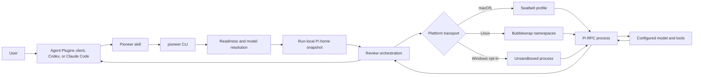

# Architecture

## Purpose and current scope

Pioneer lets coding agents run code reviews and isolated skill evaluations through the operator's installed Pi coding agent. It uses Pi's configured providers, authentication, models, and review skills.

On macOS and Linux, Pioneer starts Pi inside a native sandbox. Reviews and evals load enabled user extensions from a private snapshot. A separate policy limits inspection tools. [Pi extensions](PI-EXTENSIONS.md) defines that policy.

The current product surface is:

- a synchronous review CLI and TypeScript API;
- a fail-closed skill-eval preparation and execution CLI;
- native macOS Seatbelt and Linux Bubblewrap transports;
- one shared Agent Skill packaged for Agent Plugins v1, Codex, and Claude Code.

Background jobs, cancellation APIs, structured finding schemas, MCP transport, and automated eval grading remain possible extensions. Pioneer does not currently implement them.

Deep review adds a versioned council/president workflow with strict JSON boundaries, a bundled path-scoped inspection extension, and a separate GitHub adapter for packet collection and inline publication. Slice 10 focused command execution remains disabled.

## System view

The plugin contains instructions only. Agent Plugins v1, Codex, and Claude manifests all expose the same skill. The CLI handles policy, validation, Pi startup, sandboxing, and remote procedure calls (RPC). Every integration uses that implementation.

## Module boundaries

| Area | Main modules | Responsibility |
| --- | --- | --- |
| CLI adapters | `src/review-cli.ts`, `src/eval-command.ts`, `src/update-command.ts` | Expose the unified CLI, print results, and set exit status |
| Package updates | `src/update-check.ts`, `src/update-command.ts` | Query npm asynchronously, cache the latest result, and delegate explicit global updates to npm |
| Shared diagnostics | `src/doctor.ts`, `src/doctor-report.ts`, `src/sandbox/platform-readiness.ts` | Check Pi and native sandbox readiness for reviews and evals |
| Pi readiness | `src/pi-readiness.ts`, `src/pi-model-selection.ts` | Detect Pi, enumerate configured models, resolve exact requests |
| Pi preparation | `src/pi-home.ts`, `src/pi-startup.ts` | Copy the Pi agent directory and apply fast, ephemeral startup flags |
| Review authentication | `src/pi-auth-broker.ts`, `src/pi-auth-runtime.ts`, `src/pi-auth-client.ts`, `src/pi-auth-worker.ts` | Broker OAuth refreshes through a separate sandboxed, model-free worker; persist only provider-scoped results under Pi's source credential lock |
| Review orchestration | `src/review/runner.ts`, `src/review/resume-archive.ts`, `src/review/rpc-limits.ts` | Validate, prepare, sandbox, run bounded RPC, persist reports, retain/recover opaque native sessions, stream controller-owned work-log events, collect the final report, clean up |
| Review Git inspection | `src/review/git-inspect.ts` | Parse explicit `--git` targets, infer conservative Git-target prompts, and collect bounded read-only Git context in the controller |
| Review policy | `src/review/isolation.ts` | Canonicalize grants and prevent broad or overlapping writable access |
| Review work log | `src/review/work-log.ts` | Create bounded private JSONL logs, flush records, sanitize Pi event metadata, and manage default retention |
| Eval orchestration | `src/eval-run/setup.ts`, `src/eval-run/runner.ts` | Stage isolated eval arms, prove containment, run the actor |
| Eval fixtures | `src/eval-run/fixture-leak.ts`, `src/eval-run/fixture-source.ts` | Reject leaking fixture paths and content markers; open each fixture once and scan and stage it from that descriptor within the 64 MiB ceiling |
| Eval policy | `src/eval-run/isolation.ts` | Reject unsafe runtime grants and define public-only networking |
| Native sandbox | `src/sandbox/launcher.ts` | Compile one policy into Seatbelt or Bubblewrap argv |
| Eval actor options | `src/eval-run/actor-options.ts`, `src/eval-run/tool-extensions.ts` | Validate `--allow-loopback` and `--env` values; resolve and stage `--pi-extension` sources |
| Network mediation | `src/eval-run/public-egress-proxy.ts`, `src/sandbox/linux-proxy-bridge.ts` | Authenticate proxy use, resolve and pin destinations, bridge Linux namespaces and allowed loopback ports |
| Public API | `src/index.ts` | Export the supported TypeScript surface |
| Deep review | `src/deep-review/*`, `src/github/deep-review/*` | Versioned council/president orchestration, schemas, bundled inspection extension, and GitHub adapter |

Dependencies flow from adapters and orchestration toward validation and transport helpers. Plugin files do not duplicate policy.

## Package update lifecycle

Normal commands start an npm version check in the background. The check never delays command startup. Pioneer caches successful results for 24 hours in the operator's cache directory. It reports newer versions after the requested command finishes.

`pioneer check-update` bypasses the cooldown. `pioneer update` also bypasses it and asks npm to install an explicitly approved update. Update checks run independently of Pi readiness and the actor sandbox.

## Review lifecycle

1. Validate request scalar values and refuse Windows unless the caller explicitly opts into unsandboxed review execution, before creating any controller output.
2. Validate source, reference, and write grants, plus controller-owned report and work-log paths.
   Preflight both derived default outputs before either changes storage. Check every directory that preparation can create or chmod. Revalidate each actual randomized target during preparation.
   Resume rejects explicit and derived outputs anywhere inside the private resume store, including other tokens' archives.
   Create and announce the private work log first. Then reserve and announce the private report target with a random ownership marker and randomly named controller-owned sibling link.
   Record later stages in real time. macOS and Linux files use mode `0600`; Windows uses the per-user application-data ACL.
3. Collect bounded read-only Git context for explicit `--git` targets and Git-target prompts. Require `--source` to be the repository root.
   Use canonical Git, argument arrays, and an allowlist. Disable hooks, pager, editor, external-diff, credential helpers, LFS filters, and unsafe protocols.
   Add validated refs and output to the prompt as untrusted text. Reject GitHub pull-request targets and request an explicit local `--git` value.
   Keep collected targets in the immutable resume scope.
4. Resolve Pi through the controller's selected `PATH` and check `pi --version`. Reject versions below the minimum or malformed versions before model discovery. Warn on versions above the tested maximum.
   Prepare private configuration and enabled-extension snapshots, then discover models inside the native sandbox. Reject invalid `models.json` and its partial catalog.
   If Pi returns no models, use access-only probes to distinguish missing configuration from outer-sandbox restrictions.
   Readiness inherits only allowlisted runtime variables. It excludes provider secrets and outer-agent control state.
   Controller preparation retains `PI_CODING_AGENT_SESSION_DIR` to exclude session storage. That preparation environment never reaches the actor.

   On Windows, lookup follows `PATHEXT`. Read npm's `pi.cmd` only as a bounded generated shim. Verify its target against the installed `@earendil-works/pi-coding-agent` package's declared `pi` entry point.
   Launch that target with Pioneer's absolute Node executable and discrete arguments, without a command shell. Reuse the resolved command for review startup.
5. Resolve a requested qualified model exactly, or an unqualified model only when it is unique.
6. Copy selected `PI_CODING_AGENT_DIR` content into the private run directory. The default source is `~/.pi/agent`.
   Copy root `auth.json`, `models.json`, `models-store.json`, `settings.json`, and `AGENTS.md`. Include `skills/` for reviews and exclude it for evals.
   Skills traversal skips `node_modules/`, `.git/`, transient directories, and log files. The root allowlist excludes `npm/`, `git/`, and unknown paths. Valid skill paths such as `skills/git/` remain available.
   Reviews accept repeated exact relative `--pi-home-include` paths. Evals have no include option.
   Hard exclusions cover sessions, logs, `.npm`, `.cache`, `tmp`, `.tmp`, `temp`, and log files. macOS and Windows match these without case sensitivity.
   Below `node_modules`, directories named `sessions`, `logs`, `tmp`, `.tmp`, and `temp` contain dependency source and remain included.
   Exclude configured session storage anywhere inside the Pi home, using `PI_CODING_AGENT_SESSION_DIR` and `sessionDir`. Also identify session files by content because project settings can place them elsewhere.
   Selected content has limits of 500,000 entries and 1 GiB. Header scans have separate per-snapshot limits of 500,000 opened files and 1 GiB read. Scans of skipped files count too.
7. Build `pi --mode rpc` with offline startup and a private native session directory. The explicit opt-out uses `--no-session`.
   Disable approval, ambient extension discovery, prompt-template discovery, and theme discovery. Load explicit staged extensions and allowlisted built-in inspection tools.
   Add `--no-mcp` on Pi 1.0.4 or newer. Fail closed if a tool-restricted Pi actor's version remains unknown.
   All platforms retain `read` and `ls`. Outside Linux, exclude `write`, `edit`, `bash`, `grep`, and `find`. Linux additionally allows `bash`, `grep`, and `find` inside Bubblewrap.
   Controller-collected Git context supports Git-target reviews on every platform.

   Token loading acquires the archive lease before reading or validating retained manifests, scope, attempts, or sessions. Validation failure releases that exact lease.
   On success, hold the lease through readiness, attempt copying, and execution. Concurrent pruning cannot remove the leased recovery point.
8. Reject `--network none` for reviews before launch: the supported Pi actor needs proxy-mediated egress to its configured model provider. Start an authenticated loopback proxy for `public` or `full` networking.
9. Compile the native sandbox policy and start Pi without a shell, using a narrow actor environment on every platform.
10. Send one JSONL prompt request and collect bounded RPC events until `agent_settled`, failure, or timeout. Flush sanitized event metadata and five-second liveness heartbeats to the work log without recording prompts, assistant text or thinking, tool arguments or output, or environment values.
11. Wait for the child process and its stdio pipes to close on every terminal path, including timeout and protocol failure. Only then report completion; success additionally requires exit code zero and a non-empty final report.
12. Publish and return the verified Markdown report through the owned reservation inode. Never overwrite or delete a replacement target.
    Active reservations require the matching random sibling link and live OS process-start identity. Hold a separate random publication lease while changing the inode.
    Restore the marker after failed writes. After sync and final identity validation, handle close and sibling removal cannot invalidate the durable report.
    Later default-report retention reclaims abandoned reservation/publication siblings and inactive post-publication hard links. Protect live sidecars before target-link creation. Give incomplete markers one minute for setup.
    On strict success, delete the native archive, proxy, bridge, Pi snapshot, and scratch. On failure, remove an unpublished reservation still owned by the controller.
    After proven non-success, retain only a bounded regular session tree with exactly one native `.jsonl` session. Emit an opaque resume token.
    Cap each committed attempt at half the aggregate archive budget, leaving room for a crash-safe copy. Remove crash-left staging attempts under the archive lease before copying.
    Reject explicit and derived outputs anywhere inside the private resume store. Keep the archive when report persistence fails.
    If Pi rejects a copied session, atomically restore the manifest to the validated prior attempt.
    Post-retention pruning acquires the candidate's resume lease before deletion. Pruning failures cannot undo a committed attempt or invalidate a claimed recovery point.
    Work-log creation or write failures stop the review. Runs with resumption disabled never create or prune resume storage.

See [REVIEW-TRANSPORT.md](REVIEW-TRANSPORT.md) for the RPC contract and [SECURITY.md](SECURITY.md) for the trust boundaries.

## Review OAuth lifecycle

Native review preparation creates an authenticated refresh broker when the snapshot contains OAuth credentials. The Pi adapter sends refresh operations to that broker. It accepts only an existing provider name.

The controller reads current source credentials under Pi's shared lock. It runs the same extension snapshot in a separate model-free sandbox. This worker has no source or review-scratch grant and follows the review's network policy.

The controller saves validated provider results before cleanup and returns them to the private review credential store. Concurrent reviews and ordinary Pi reuse these rotations. The review actor cannot choose data written to source credentials. [Security](SECURITY.md#oauth-refresh-in-native-reviews-and-evals) defines the remaining limits.

## Eval lifecycle

Eval preparation validates `skill_name` as one portable path component within the cross-platform filename byte limit. It rejects revealing fixture paths or contents with `[EVAL_FIXTURE_LEAK]`.

Each fixture must be a regular file of at most 64 MiB. Pioneer checks it through an open descriptor with `fstat`, scans it, records its identity, and closes it. Oversized files fail with `[EVAL_FIXTURE_TOO_LARGE]`. Staging reopens each file and rejects identity changes with `[EVAL_FIXTURE_CHANGED]`. It rescans every copied byte.

Preparation canonicalizes the output parent and revalidates the created destination before writing. It creates controller-only metadata and independent `baseline` and `with-skill` directories. Only the with-skill arm receives a sanitized skill copy.

Before constructing grants, execution rejects broad or protected-system writable run directories. It rejects overlapping caller runtime-read grants, Pi homes inside any actor grant, and Pi package roots overlapping the run tree. Executable reads already covered by the writable run grant receive no redundant read-only grant.

Controller launch/probe files and the Pi snapshot live outside the persistent run in a canonical private temporary tree. The default base is `/tmp` on macOS/Linux and `os.tmpdir()` on Windows. The Linux bridge uses the same short base to keep its Unix socket within `sun_path`.

Review and eval callers can select `controllerScratchBase`. Pioneer canonicalizes it and rejects missing paths, non-directories, broad/protected system paths, and bases too long for the bridge socket. Actor write grants follow this base, so writable-run safety rules also apply to it.

Pi receives an isolated writable `agentDir` for configuration and lock directories such as `auth.json.lock` and `settings.json.lock`. Home/tmp scratch is separate and writable. Pioneer never mounts the source Pi home.

For the trusted official Pi package, Pioneer stages enabled user extensions read-only. Explicit `--extension` paths load them while `--no-extensions` blocks ambient discovery. The adapter removes extension tools and retains provider/authentication hooks.

An actor command containing `--no-extensions` or `-ne` selects built-in providers. OAuth still uses the broker when credentials exist and the package supports the auth adapter. Explicit `--extension` or `-e` paths still load through the tool-stripping adapter. Evals have no `--pi-home-include`.

An outer interruption scope covers validation through cleanup. It removes temporary material after success, failure, or signal. Each run opens a controller-owned default or custom JSONL log and prints `[PIONEER_EVAL_WORK_LOG] ABSOLUTE_PATH`.

Before launch, mandatory probes check denial of outside-sentinel reads/writes, host-only secrets, and direct host loopback connections.

Operators can add three narrow capabilities:

- `--allow-loopback` opens exact host ports. The probe tests an unlisted port under the same policy.
- `--env` adds non-reserved actor variables. Pioneer's variables take precedence.
- `--pi-extension` retains one staged extension's tools. It initializes only in the actor.

Model discovery and the OAuth worker omit `--pi-extension`. They lack the actor's variables, run directory, Pi arguments, and allowed loopback ports needed by some tool adapters.

Before creating isolation artifacts, the controller resolves the actor executable. Bare names use sanitized `PATH`; relative paths use the validated run directory. Absolute paths resolve directly. Pioneer requires a regular executable and passes its canonical target to the launcher.

`/usr/bin/env` shebang checks read a bounded prefix and follow canonical interpreters within cycle/depth limits. When lexical and canonical launcher paths differ, both receive exact read-only grants. Parent roots remain unchanged. Pi detection and startup optimization use the original command before this rewrite.

On macOS and Linux, the capture controller starts the sandbox in a separate process group. It forwards timeout/interruption signals to the group and waits for stdio and process closure.

Descendants retaining pipes beyond the bounded grace produce `[EVAL_PROCESS_CONTAINMENT_FAILED]`. Linux destroys descendants with the actor's PID namespace, so this diagnostic is unreachable there. Timeout, interruption, spawn, and output-limit failures exit nonzero and preserve bounded partial stdout/stderr.

The eval runner is an isolation primitive. It does not schedule all cases, call a grader, compare scores, or publish a report. See [EVALS.md](EVALS.md).

## Extension points

- A job service can wrap `runReview` without changing review policy.
- MCP or richer client adapters can translate inputs and presentation while calling the same API.
- Structured findings can be introduced as a versioned result contract after Pi output validation is implemented.
- Additional sandbox backends must satisfy the same path, environment, network, and mandatory-probe invariants.
